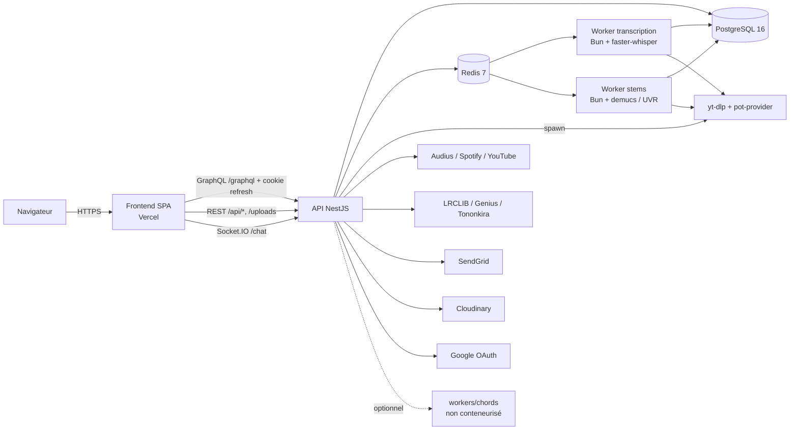
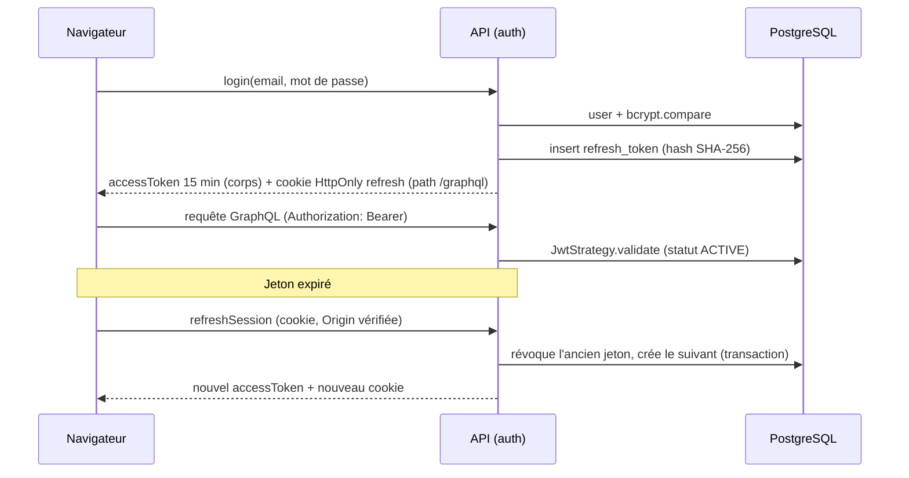
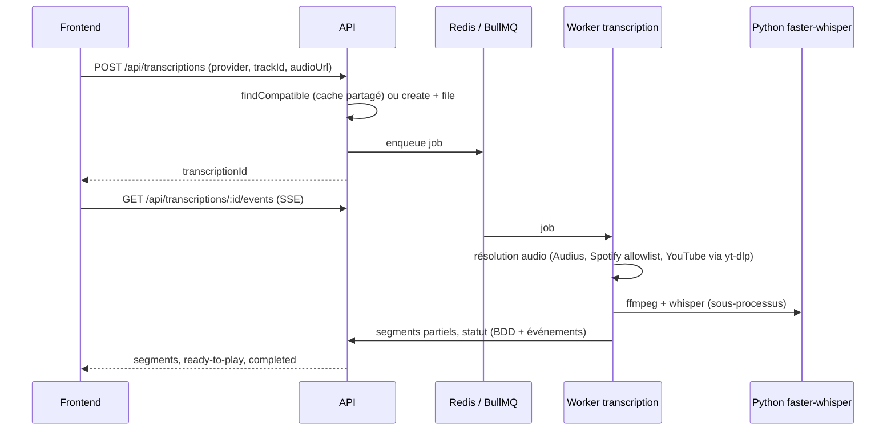
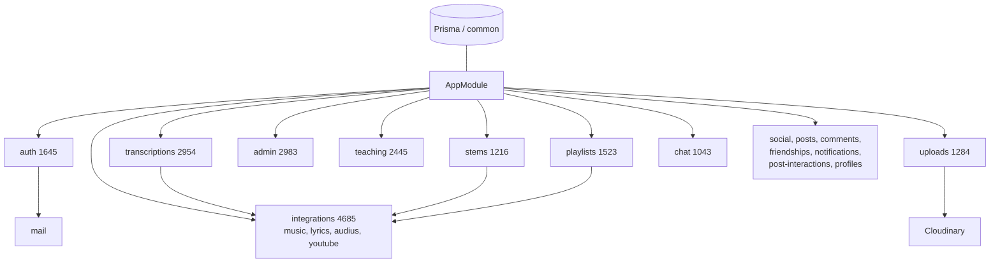

# Architecture réelle

## Composants et technologies (versions lues dans les manifestes)

| Composant | Technologie | Version | Rôle |
|---|---|---|---|
| Frontend | React, Vite, TypeScript, Tailwind | 18.3 / 8.3.3 / 5.9 / 3.4 | SPA ; routage `react-router-dom` 7.18, cache `@tanstack/react-query` 5, i18n `i18next` (fr, en) |
| API | NestJS, Apollo Server, Express 5 | 11 / 5.5 / — | GraphQL (≈170 déclarations `@Query`/`@Mutation`, 88 mutations), 8 contrôleurs REST (32 routes), Socket.IO `/chat` |
| ORM / BDD | Prisma, PostgreSQL | 7.10 / 16 | 43 modèles, 38 migrations, 86 index |
| File / limites | Redis, BullMQ, ioredis | 7 / 5.81 / 6 | Files de transcription et stems, limitation de débit |
| Workers | Bun + Python 3 | Bun 1.4.4 | `worker.ts` (transcription), `stems-worker.ts`, scripts `workers/*` |
| IA / audio | faster-whisper 1.2.1, demucs 4.0.1, audio-separator 0.48.0, BTC + beat-this | — | Transcription, séparation voix, accords |
| Extraction YouTube | yt-dlp 2026.8.19 + `bgutil-ytdlp-pot-provider` | — | Audio pour transcription |
| Externes | Audius, Spotify, YouTube, LRCLIB, Genius, Tononkira, SendGrid, Cloudinary, Google OAuth | — | Voir flux ci-dessous |
| Hébergement | Vercel (frontend), Render (`render.yaml`, worker) ou VPS (`docker-compose.vps.yml` + Caddy) | — | CSP du frontend : `connect-src` vers `*.onrender.com` et `flowfret.duckdns.org` |

Runtime : l'image de production est `node:22-bookworm-slim` avec Bun copié depuis `oven/bun:1.4.4`. En local, Node 24 est installé (écart avec Node 22 en image).

## Architecture globale

## Flux : authentification et rafraîchissement

## Flux : transcription d'un morceau

## Dépendances entre modules backend (taille en lignes, hors tests)

Garde-fous globaux (`AuthModule`) : `GqlJwtAuthGuard` (tout est protégé sauf `@Public()`), `RolesGuard`, `RateLimitGuard` enregistrés en `APP_GUARD`. `main.ts` : `helmet()`, CORS à liste blanche, `ValidationPipe` (`whitelist`, `forbidNonWhitelisted`), limite de corps JSON (64 ko par défaut), `trust proxy` à 1 en production.

## Structure des dépôts

Le dossier `guitare/` **n'est pas un dépôt git**. `backend/` (branche `master`, remote `flowfret-jr-backend`) et `frontend/` (branche `main`, remote `flowfret-jr`) sont deux dépôts indépendants, chacun avec sa CI (`.github/workflows/ci.yml`). Les fichiers à la racine (`README.md`, `AGENT.md`, `docs/`, `.vscode/`, `.github/`, `.venv/`) ne sont suivis par aucun.

## Fichiers inutiles, dupliqués ou mal placés

- `guitare/.github/workflows/ci.yml` : copie orpheline et périmée (CI-03).
- `frontend/films/` et `frontend/test-results/` : fichiers retirés du suivi (REPO-01).
- `backend/youtube-cookies.txt`, `backend/.env` : réels, ignorés et non suivis (vérifié avec `git ls-files`).
- `backend/dist`, `backend/dist-dev`, `backend/coverage`, `frontend/dist`, `frontend/debug.log` : sorties de build ou journaux locaux (ignorés).
- `.venv/` à la racine : environnement Python local hors dépôt.
- `workers/chords/__pycache__`, `workers/*/__pycache__` : ignorés (`__pycache__/` dans `backend/.gitignore`).
