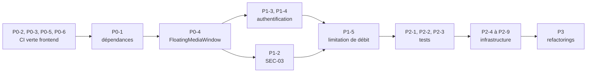

# Feuille de route de remédiation

Ordre pensé pour **ne pas introduire de régressions** : d'abord rendre les signaux (CI, tests) fiables, ensuite corriger le produit avec des tests de caractérisation, enfin refactorer. Chaque tâche indique ses dépendances. Complexité : S < 2 h, M < 1 j, L > 1 j. Aucune de ces tâches n'a été réalisée par l'audit.

## P0 — Urgent (débloque la CI et la mise en production)

| ID | Tâche | Anomalie | Fichiers | Dépend de | Cplx | Critères d'acceptation | Validation |
|---|---|---|---|---|:-:|---|---|
| P0-1 | Mettre à jour les dépendances de production vulnérables (`axios`, `follow-redirects`, `body-parser`, `proxy-addr`, `cheerio`/`undici`) | SEC-01 | `backend/package.json`, `bun.lock` | — | M | `bun audit --audit-level=high` sort avec code 0 ; aucun changement de comportement HTTP sortant | `bun run validate` + tests des fournisseurs (Audius, LRCLIB, Genius, SendGrid, Cloudinary) |
| P0-2 | Exclure `films/` du lint (ou l'extraire) | CI-01 | `frontend/eslint.config.js` | — | S | `eslint .` : 0 erreur | CI frontend, étape Lint verte |
| P0-3 | Mettre à jour les 2 tests de navigation périmés | TEST-02 | `navigation.test.ts`, `MenuPage.test.tsx` | — | S | Les 2 tests passent et reflètent « Bibliothèque » | `vitest run` |
| P0-4 | Analyser les 5 tests `FloatingMediaWindow` | TEST-02 | `FloatingMediaWindow.test.tsx`, `FloatingPanelWindow.tsx` | — | M | Cause identifiée ; tests verts ou code corrigé | `vitest run` |
| P0-5 | Analyser les 4 tests backend en échec | TEST-04 | `app.controller.spec.ts`, `genius-lyrics.provider.spec.ts`, `listening-history.service.spec.ts`, `teaching.resolver.spec.ts` | — | S à M | `jest` : 0 échec | `bun run validate` |
| P0-6 | Retirer du dépôt frontend les médias et résultats de tests ; ignorer `test-results/` | REPO-01 | `.gitignore`, `films/`, `*.mp4` | P0-2 | S | Poids du dépôt réduit ; plus de fichier généré suivi | `git ls-files` |

Condition de sortie P0 : les deux CI (`backend`, `frontend`) sont vertes.

## P1 — Prioritaire (sécurité, authentification, intégrité)

| ID | Tâche | Anomalie | Fichiers | Dépend de | Cplx | Critères d'acceptation | Validation |
|---|---|---|---|---|:-:|---|---|
| P1-1 | Décider et implémenter : vérification d'e-mail (comptes `PENDING`) **ou** retrait du code mort | SEC-02, DB-03 | `auth.service.ts`, `email-verification.service.ts`, `useAuthGateFlow.ts` | décision produit | M | Un compte ne devient `ACTIVE` qu'après vérification, ou le code mort est supprimé | Tests d'inscription, de vérification, de renvoi ; test de non-régression Google |
| P1-2 | Lier l'URL audio Spotify au `trackId` côté serveur | SEC-03 | `transcription-audio-source.service.ts`, `transcription-workflow.service.ts` | test de caractérisation | M | Impossible de créer une transcription pour `trackId` B avec l'audio A | Test unitaire de l'attaque, plus E2E |
| P1-3 | N'effacer la session que sur 401 explicite ; verrou entre onglets | FUNC-01 | `graphqlClient.ts`, `AuthProvider.tsx` | — | M | Un 429, 5xx ou réseau ne déconnecte pas ; deux onglets ne se déconnectent pas mutuellement | `graphqlClient.test.ts` étendu ; test à deux onglets |
| P1-4 | Détection de réutilisation du jeton de refresh (révocation de la famille) | SEC-04 | `auth-session.service.ts` | P1-3 | M | Rejeu d'un jeton déjà tourné ⇒ toutes les sessions révoquées et événement journalisé | Test de service |
| P1-5 | Politique de limitation de débit par défaut sur les mutations | SEC-07, SEC-08 | résolveurs `teaching*`, `post-interactions`, `profiles`, `notifications`, `audit-logs` | — | M | Aucune mutation utilisateur sans plafond ; `recordActivity` limité | `rate-limit.guard.spec` + test de décorateur par résolveur |
| P1-6 | Épingler `pot-provider`, `bgutil-ytdlp-pot-provider` ; somme de contrôle des modèles | SEC-13, SEC-05 | `docker-compose.yml`, `requirements.youtube.txt`, `setup_models.py`, `analyze.py` | — | S | Images et paquets figés ; modèle vérifié par sha256 | Build Docker, `python -m unittest` |
| P1-7 | Exclure `youtube-cookies.txt` du contexte Docker ; fichiers d'environnement par service | SEC-10, SEC-11 | `.dockerignore`, `docker-compose.yml` | — | S | Les workers ne reçoivent que leurs variables | `docker compose config` |
| P1-8 | Auditer l'historique git de `backend` et `frontend` avec `gitleaks` ; faire pivoter la session YouTube si nécessaire | SEC-10 | — | — | S | Rapport `gitleaks` sans secret, ou rotation faite | `gitleaks detect` |

## P2 — Important (architecture, tests, exploitation)

| ID | Tâche | Anomalie | Fichiers | Dépend de | Cplx | Critères d'acceptation | Validation |
|---|---|---|---|---|:-:|---|---|
| P2-1 | Tests de résolveurs/contrôleurs vérifiant les gardes | TEST-01 | `chat.resolver`, `uploads.resolver`, `music.resolver`, `lyrics.controller` | P0-5 | L | Couverture de fonctions backend ≥ 45 % ; chaque opération sensible a un test d'autorisation | `jest --coverage` |
| P2-2 | Job d'intégration (PostgreSQL + Redis) : concurrence des quotas et du chat | TEST-01 | CI backend, `test/` | P0-1 | L | Test reproduisant les verrous transactionnels | CI |
| P2-3 | Ajouter les E2E Playwright à la CI frontend | CI-02 | `frontend/.github/workflows/ci.yml` | P0-2 | M | 14 scénarios exécutés en CI | CI |
| P2-4 | Conteneuriser ou documenter l'exclusion de l'analyse d'accords | DOCKER-01 | `Dockerfile*`, `docker-compose.yml`, `workers/chords` | décision produit | M | `CHORD_ANALYSIS_ENABLED` activable en conteneur, ou documenté comme local seulement | Build + test de démarrage |
| P2-5 | Purge planifiée des jetons ; retirer `recover-known-migration.mjs` | DB-01, DB-02 | nouvel `@Interval` ou tâche, `package.json` | P2-2 | M | Table des jetons bornée ; démarrage sans script de contournement | Test unitaire ; essai sur copie de la base |
| P2-6 | Documenter et tester sauvegarde / restauration | OPS-01 | `docs/`, `README` | — | M | Procédure écrite et restauration réussie sur un environnement jetable | Exercice de restauration |
| P2-7 | Ajouter build Docker, `trivy`, `gitleaks`, `pip-audit chords` à la CI | CI-02 | workflows | P0-1 | M | Étapes présentes et vertes | CI |
| P2-8 | Décider du sort de la collaboration de playlists et des 44 opérations inutilisées | FUNC-02, SEC-14 | frontend `playlists`, résolveurs | décision produit | L | Interface livrée ou opérations retirées | Tests + revue du schéma |
| P2-9 | Healthchecks, `read_only`, `tmpfs` pour les workers | DOCKER-02 | `docker-compose.yml`, `Dockerfile.worker/stems` | P2-7 | S | Conteneurs sains et redémarrés automatiquement | `docker compose ps` |

## P3 — Amélioration

| ID | Tâche | Anomalie | Cplx | Critère |
|---|---|---|:-:|---|
| P3-1 | `.gitattributes`, `.editorconfig`, `endOfLine: "lf"` | QUAL-01 | S | `bun run lint` à 0 erreur sur Windows et Linux |
| P3-2 | Corriger les clés i18n et le mojibake | I18N-01, I18N-02 | S | Test de parité de clés fr/en ; messages lisibles |
| P3-3 | Découper `TeachingPage.tsx`, `teaching.resolver.ts` | ARCH-01 | L | Aucun fichier > 500 lignes dans ces deux domaines ; tests inchangés |
| P3-4 | Génération de types GraphQL | ARCH-02 | L | Types client dérivés du schéma ; build casse si un champ disparaît |
| P3-5 | TypeScript backend : activer `noImplicitAny` module par module | BUILD-01 | L | `tsc` sans erreur avec `noImplicitAny: true` |
| P3-6 | Externaliser l'état en mémoire (chords, origines du chat, planificateurs) | ARCH-03, SEC-09 | M | Comportement identique avec 2 instances |
| P3-7 | Mettre à jour `ts-jest` (handlebars) et dépendances de développement | SEC-12 | S | `bun audit` sans *critical* |
| P3-8 | Supprimer `guitare/.github/` ; versionner `docs/` | CI-03 | S | Un seul emplacement de CI et de documentation |
| P3-9 | Rapport de bundle et mesures de performance ; test d'accessibilité axe | PERF-01 | M | Budgets définis |

## Ordre de correction recommandé

Règles de prudence : écrire un test de caractérisation avant chaque correction de P1 ; une tâche par changement ; relancer `bun run validate` à chaque étape ; ne jamais modifier une migration déjà appliquée (créer une nouvelle migration).
